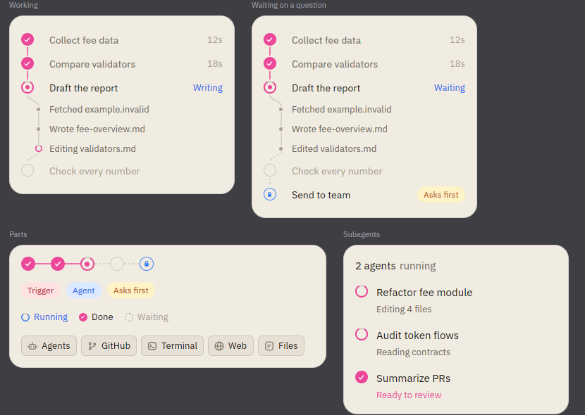
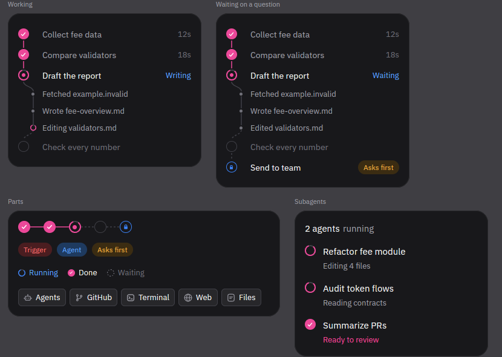
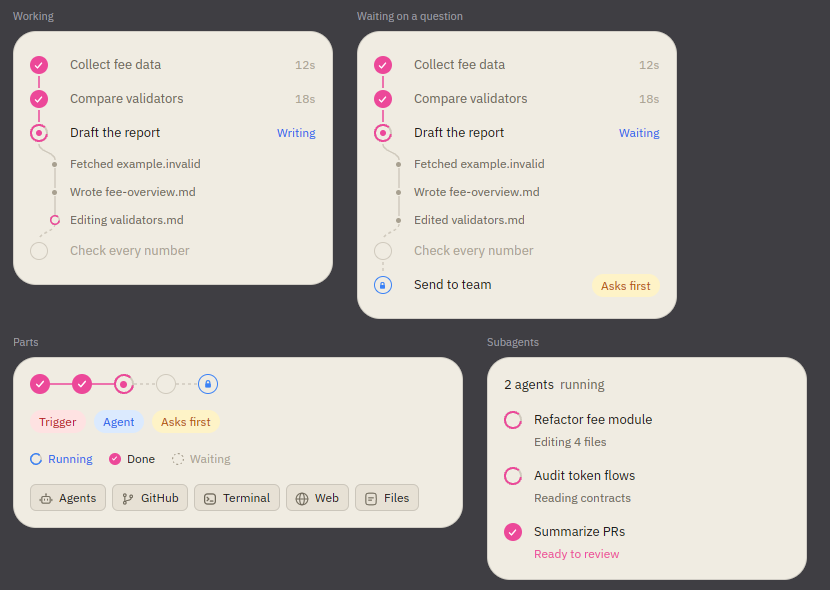
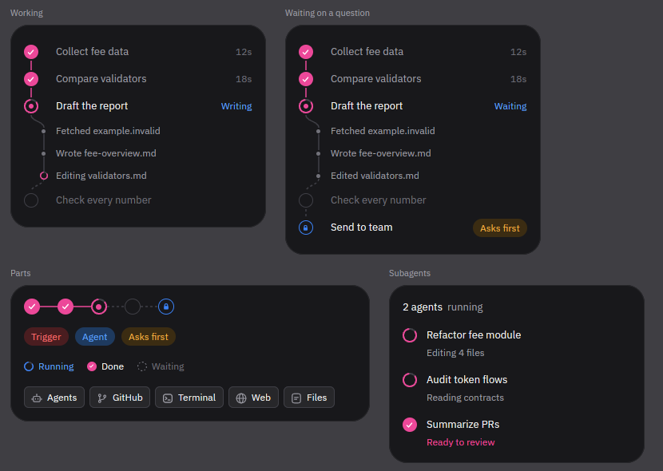

# Harness interface design

This document records the interface that Harness currently ships. It is a reference for extending the desktop app without changing its visual language. The implementation remains the source of truth: [`crates/ui/src/theme.rs`](crates/ui/src/theme.rs), [`crates/ui/src/settings/widgets.rs`](crates/ui/src/settings/widgets.rs), and [`docs/theme-system.md`](docs/theme-system.md).

## Product shape

Harness is a native workspace for coding agents. Its persistent sidebar holds spaces, sessions, navigation, and account status; the main panel holds a conversation, files, terminal, or settings. A compact composer stays close to the transcript. Settings use a quiet left navigation and a centered content column. The interface favors readable work over decorative chrome.

New installs select **Codegraff Light** and **Codegraff Dark**. These are two authored palettes, not color inversions. Users can choose other bundled or imported themes, an independent accent, and a frosted or opaque surface preference. UI components consume semantic theme roles instead of hard-coded theme colors.

## Color and surfaces

| Role | Codegraff Light | Codegraff Dark |
| --- | --- | --- |
| Main background | `#faf8f3` | `#16140f` |
| Sidebar and cards | `#f0ece3` | `#1f1c16` |
| Raised control | `#e7e1d5` | `#2a261e` |
| Primary text | `#1a1813` | `#edeae2` |
| Muted text | `#6b6557` | `#9a9384` |
| Accent | `#c77d20` | `#e8a33d` |

The Codegraff palettes start opaque. The **Frosted glass** switch in Settings → Appearance turns on frost: the window blurs what sits behind it, tinted from the mapped shell roles. In light mode the white content plane advances and the warmer sidebar recedes; in dark mode the content plane is darkest and raised controls get lighter. Borders and restrained shadows separate light cards. Accent marks actions, focus, selection, activity, and usage below warning thresholds. Warning, danger, success, diff, syntax, and terminal colors keep their own meanings. Palette definitions live in [`crates/theme/src/builtins.rs`](crates/theme/src/builtins.rs).

## Type, rhythm, and shape

- Geist is the default interface face; Geist Mono is available for fixed-width UI, code, and terminal surfaces. The user can change interface, code, and terminal typography independently.
- Settings pages use a centered column no wider than **768 px**, with **24 px** side padding, **32 px** top padding, and **64 px** bottom padding. Titles are **16 px semibold**, subtitles **13 px muted**, and compact row titles/descriptions **13/12 px**.
- The base spacing steps are **4, 8, 12, and 16 px**. Closely paired labels and descriptions can use a 1 px optical gap.
- Message bubbles use a **16 px** radius, panels and cards **10 px**, and small controls **6 px**. Borders are hairlines; they organize the page without turning every item into a box.
- Hover, active, focused, disabled, loading, warning, and error states have distinct treatments. Motion should explain a state change and leave content legible.

## Design rules

These six rules apply to every new or changed surface. Each one names the shared token to use, so a component never carries its own copy of the value. The first five come from Juliette ([@shedsgns](https://x.com/shedsgns/status/2116198444595388434)); the sixth from Michael Filipiuk ([@MichaelFilipiuk](https://x.com/MichaelFilipiuk/status/2115791791568105887)).

1. **Hit areas are bigger than the icon.** A clickable glyph or chip keeps its visible size, and its pointer target grows around it to at least `Theme::HIT_TARGET` (**32 px**). Grow the target with padding cancelled by an equal negative margin, so the visual does not move, and key the hover tint to the target with `group` / `group_hover`. Neighbouring targets meet in their shared gutter without overlapping. See `context_usage::hit_area` and `HitSlop`. A row that clips its children (`overflow_hidden`) also clips hitboxes, so a target in the 24 px composer footer is 24 px tall and grows only in width.
2. **Numbers that change use tabular figures.** Token counts, savings, percentages, timers, durations, counters, and chart captions use `.tabular_nums()` (`typography::TabularNums`, OpenType `tnum`). Geist's default digits are proportional, so without it a ticking value shifts the text beside it.
3. **Motion starts fast and lands gently.** Use `motion::EASE_OUT_QUINT`, `cubic-bezier(0.22, 1, 0.36, 1)`, through `MotionSpec`. Keep enters and fades at **250 ms or less** (the agent work enter is **180 ms**, the context status fade **240 ms**) and a whole multi-part transition under **800 ms** (the context bar runs **460 ms** plus a **45 ms** stagger per block). Linear timing is only for continuous rotation such as spinners. Reduced motion snaps every transition.
4. **Align optically, not mathematically.** A dot, check, spinner, or icon centered on a line box reads high, because Geist's cap height sits below the box's center. Center such glyphs on the letters: move the glyph down, or the text up, by `typography::CAP_CENTER_NUDGE` (**1 px** at 11 to 15 px). Where a connector or another drawing is tied to the glyph, move the text instead. Check by measuring a screenshot: the glyph's ink center and the label's cap center should agree within 0.5 px.
5. **Nested corners are concentric.** An element inset inside a rounded surface is rounded at `outer - border - padding`: `popover::nested_radius(outer, border, padding)`, or the inverse `popover::outer_radius(inner, border, padding)` when the inner radius is fixed. Menu rows are `nested_radius(CARD_RADIUS 12, 1, CARD_INSET 4)` = **7 px**. The agent work card is `outer_radius(Theme::CONTROL_RADIUS 6, 1, 16)` = **23 px**, concentric with the tool chips in its corner. When the result is zero or less, the inner element is square.
6. **Use fewer font sizes and weights.** Compact surfaces (cards, popovers, the composer footer) use three sizes and two weights from `typography`: `TEXT_TITLE` **13 px**, `TEXT_BODY` **12 px**, `TEXT_CAPTION` **11 px**, and `WEIGHT_REGULAR` / `WEIGHT_STRONG` (medium). Build hierarchy beyond that with the theme's text colors (`text`, `text_muted`, `text_faint`) rather than another size or weight. Settings pages keep their documented 16 / 13 / 12 px scale.

   The context card, the agent work card, and their footer chips used five sizes (15, 14, 13, 12, 11 px) and three weights (regular, medium, semibold). They now use the three sizes and two weights above. The agent work card, before and after:

   | | Light | Dark |
   | --- | --- | --- |
   | Before |  |  |
   | After |  |  |

### Savings in the context card

The context card shows what graff kept out of the context as one number and one meter, not a list. The number is the tokens kept out (`ContextSavings::kept_out_tokens`: tool output kept in files plus what compaction freed), in `TEXT_TITLE` and `WEIGHT_STRONG`, followed by "saved by graff" in `text_muted`. Below it, a meter with the context bar's geometry (62 segments, 4 px wide, 2 px apart, 1.5 px corners, 8 px tall) splits in-context plus saved tokens into three parts: in context now (neutral), tool output (the Files color), and compaction (the summary blue). Every part that holds anything keeps at least one segment. One caption line under the meter names the parts; hovering a part replaces it with that part's exact count. Each part's hover target grows to `Theme::HIT_TARGET` tall without moving the meter. Provider cache reads are not shown: those tokens were in the context, only cheaper. With no savings reported the meter is absent, never "0 saved". See `savings_meter` and `saved_segments` in [`crates/ui/src/context_window.rs`](crates/ui/src/context_window.rs).

## Settings and account cards

Settings pages share `PageScroll`, `page_column`, `page_header`, `page_subtitle`, and `section_card` from [`crates/ui/src/settings/widgets.rs`](crates/ui/src/settings/widgets.rs). The Accounts page in [`crates/ui/src/settings/accounts.rs`](crates/ui/src/settings/accounts.rs) groups logins by provider. Each group has a brand glyph and an Add account action; its rows show identity, active state, plan, usage windows, and account actions. A quiet device switcher in the header changes which host's local agent logins are shown.

Usage belongs **inside the existing account row**. Each window uses a short label, a 5 px rounded meter, a percentage, and a subdued reset time. It uses the theme accent below 80% used, warning at 80%, and danger at 95%. Keep the provider ordering and card geometry stable as live values refresh; loading or unavailable data should not rearrange the page. The CodeGraff account section uses the same card geometry for credit balance, recent spending, and an optional monthly key-budget meter. It reads the selected device's Graff CLI account; Harness sync sign-in is a separate account state.

## Conversation and interaction

The conversation is the primary work surface. User messages and agent output have distinct alignment and hierarchy; tool calls, code, files, errors, and timestamps remain readable within the same transcript. The composer shows the selected agent, model, and reasoning level without hiding the prompt. Once a chat exists, its agent is fixed; model and reasoning changes stay within that agent. Popovers and dialogs use the same theme roles and compact controls as the rest of the shell. The context ring and percentage stay at the bottom-right of the composer footer, with token savings and detailed counts in the hover card. The context indicator stays muted until the warning and danger thresholds. This follows Phil Hedayatnia's composer work in the [hedayatnia/harness](https://github.com/hedayatnia/harness/tree/codex/dia-composer) fork.

The desktop composer follows the selected Dia reference: an opaque writing plane with **16 px** corners, a fine edge, two restrained downward shadows, and a send/stop action filled with the theme’s primary accent. Its icon uses a contrast-checked foreground on that fill. Light appearances lift the theme's input tint toward white; dark appearances retain the raised input color. Focus adds an accent-tinted edge. The new-session box starts at **104 px** and grows with the draft, while the compact layout and existing controls remain available. Placeholder text uses the muted text role. The message input paints a **3 px** rounded caret in the theme's primary accent color (including the user's accent override), inset **2 px** from the line box. Edits and caret movement reset its 500 ms blink phase; reduced motion keeps it steady. Selection, wrapping, and IME geometry remain owned by the existing editor. The model switcher has a stable anchor at the bottom-left below the writing surface. Workspace controls follow it when space permits; the context ring and percentage stay at the bottom-right, with token savings and detailed counts in the hover card. The context indicator stays muted until the warning and danger thresholds.

Use plain, specific copy for actions with data consequences. Local versus synced workspace state belongs in the account area. Importing existing chats into sync requires an explicit choice, and the interface should state when another signed-in device can request access to the host's workspace.

## Model picker

One composer chip opens one card: a favorites star and one brand icon per offered agent across the top, a search row, the model list, and a pinned tray for reasoning and model options. An existing chat shows only its own agent. A search filters the viewed tab only; switching tabs re-scopes the same query. Rows on an agent tab are compact single lines: model name, muted attribution, a ⌘1–⌘9 chip, and a star. The favorites tab mixes agents, so its rows add a brand subline. Hover moves the one keyboard highlight; the selected model gets the stronger wash and ring.

Some agents serve models from several providers at once. Graff lists every provider the account is signed in to, and opencode lists its connected providers, both as `provider/model` ids. When an agent tab spans two or more providers, its rows sit under provider headers in first-appearance order, so the current model's provider leads. Starred models get a **Starred** section on top. Headers are **11 px semibold** muted text at exactly the height of a row, because the list is virtualized and sizes every item from the first. They are never highlighted or picked, and arrows and ⌘N skip them. A row under a header drops the provider prefix from its attribution ("kimi · 262k context" reads "262k context"). Single-provider tabs and search results stay flat. See `scoped_model_rows` and `render_model_header` in [`crates/ui/src/pickers.rs`](crates/ui/src/pickers.rs).

## Tabs, split panes, and composer picks

⌘D and ⌘⇧D split the conversation column like Ghostty; ⌘T opens a tab. ⌘D always splits, however narrow the column; it never turns into a tab. The focused pane is the selected chat with the composer; other panes are dimmed, read-only transcripts, and clicking one moves focus there.

Each tab and pane owns its selection, project filter, and composer picks (agent, model, reasoning). A new pane or tab starts from the picks of the pane it was opened from. Leaving a pane or tab parks its picks, and coming back restores them. The sticky last-used defaults only seed a new-session canvas with nothing parked, such as after a restart. An existing chat's picks live on the chat itself. See [`crates/ui/src/shell/chat_split.rs`](crates/ui/src/shell/chat_split.rs) and [`crates/ui/src/shell/chat_tabs.rs`](crates/ui/src/shell/chat_tabs.rs).

## Image annotation

Clicking an image in the chat or the composer opens the preview, and its bottom-right **Annotate** pill turns it into the editor. A bottom-center pill holds the tools (Text, Rectangle, the default), four color dots (red, the default, then blue, green, yellow) and Undo. A second pill beside it holds Cancel and Done. Dragging draws a 2 px box with a numbered pin on its top-left corner, and letting go opens a one-line **Add a note…** popover under the box with a delete button. The Text tool drops a filled chip with the typed words. Enter commits a note, Esc commits it or leaves the editor, Backspace or Delete removes the selected mark, and ⌘Z undoes.

Every control is at least 32 px to hit. Pin numbers and box coordinates use tabular figures. The editor uses the shared 180 ms ease-out-quint entrance and skips it under reduced motion. Type sticks to 11, 12 and 13 px in regular and medium. Radii nest: 21 px pills around 16 px buttons, 10 px popovers around 6 px controls. The popover and pills take theme surfaces, so both appearances read correctly; the mark colors are fixed so a flattened image means the same thing everywhere.

Done flattens the marks into a new PNG at the image's own resolution (the marks are drawn at screen size, then scaled), stages it in place of the original, and sends the numbered notes with the prompt as text with box coordinates in image pixels. See [`crates/ui/src/annotate.rs`](crates/ui/src/annotate.rs) and [`docs/annotate.md`](docs/annotate.md).

## iOS Home and iPhone Duo

The iOS session list reads like a messages list. A **27 pt** semibold "Sessions" title, then a pinned row of agent avatars (only while something is pinned and no search is active), then the filter chips. Every row starts with the session's agent as a 44 pt avatar, then the name at **16 pt** semibold, the "space @ device" line at **14 pt**, and the branch, times and status words at **12 pt**. Two weights only, regular and semibold. Times use tabular figures. Content sits on a **24 pt** side gutter with no row dividers. Chips are 36 pt capsules on Liquid Glass with a faint ink fill, a little deeper when changed from the default, never a solid fill; their hit area stays 44 pt. A finished run with an unread reply shows its time and a dot in the accent color; red stays for failures. The pressed and selected row wash uses an 18 pt continuous radius, concentric with the avatar it surrounds. See `ChatRow`, `PinnedRow` and `HomeControlPill` in `apps/ios`.

Layout follows size classes and the space the window has, since on iPhone Duo and in iPhone Mirroring an iPhone app can have any combination. Regular width and height on iPad shows the list beside the open session. iPhone Duo's inner display (an iPhone window regular both ways) lying flat is the ordinary one-column iPhone app; only folded like a book does it put the list and the session on either side of the fold. See `HomeColumns`. Regular width with compact height (a Max in landscape) can also show two sessions side by side. Compact width keeps the single stack or the opt-in phone split. On iPhone Duo, an active fold (`.division` reserved region) puts the list and the session on either side of it in book pose and stacks them in laptop pose, and active `.occlusion` regions push content clear. See `apps/ios/Harness/Theme/FoldLayout.swift`.

## Status and tag chips

Status pills, tags and badges (Working, Needs you, Failed, Queued, a pull request number, a "git" tag) use a soft tint of their hue behind darker, saturated text in that same hue. Never a solid saturated fill with white text: it is harder to read and shouts over the row it labels. On iOS the tint is the hue at **12%** in light and **16%** in dark, and the text is the hue mixed **35%** toward black in light or **20%** toward white in dark. With those values every status hue on both Codegraff appearances (danger, warning, success, accent) measures at least **4.5:1** against its tinted chip. No border on the chip. Use `tintedChip(_:)` / `StatusChip` in `apps/ios`, and recheck contrast when adding a hue or a theme. Reference: [@marcelkargul](https://x.com/marcelkargul/status/2115949035009814905).

## Extending the design

Reuse semantic `Theme` colors, typography helpers, shared settings widgets, existing icons, and the current account-row layout. Check both Codegraff appearances and a contrasting third-party theme. Review ordinary, hover, focus, loading, offline, error, and high-usage states. [`docs/theme-system.md`](docs/theme-system.md) lists the theme validation and visual review surfaces.
